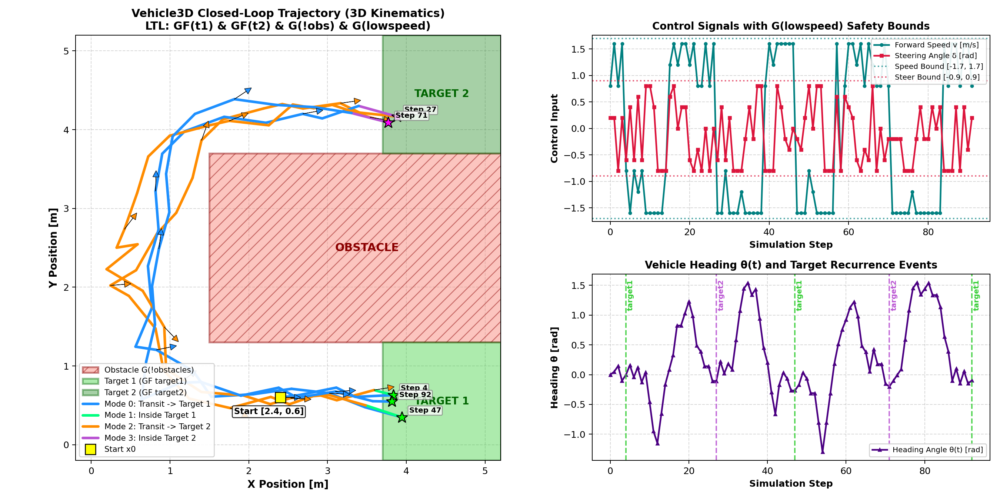
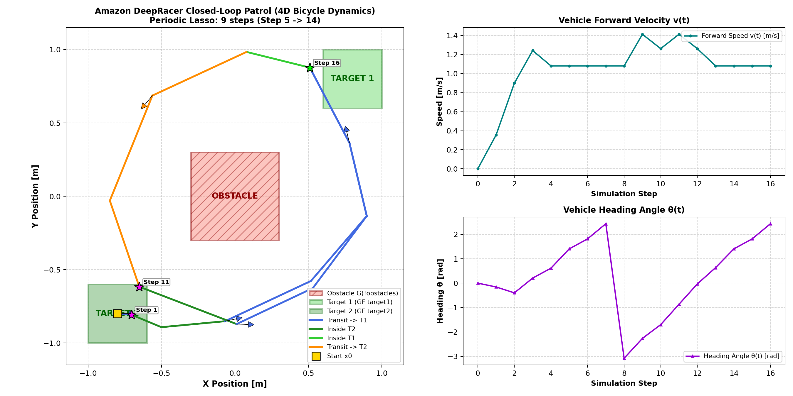
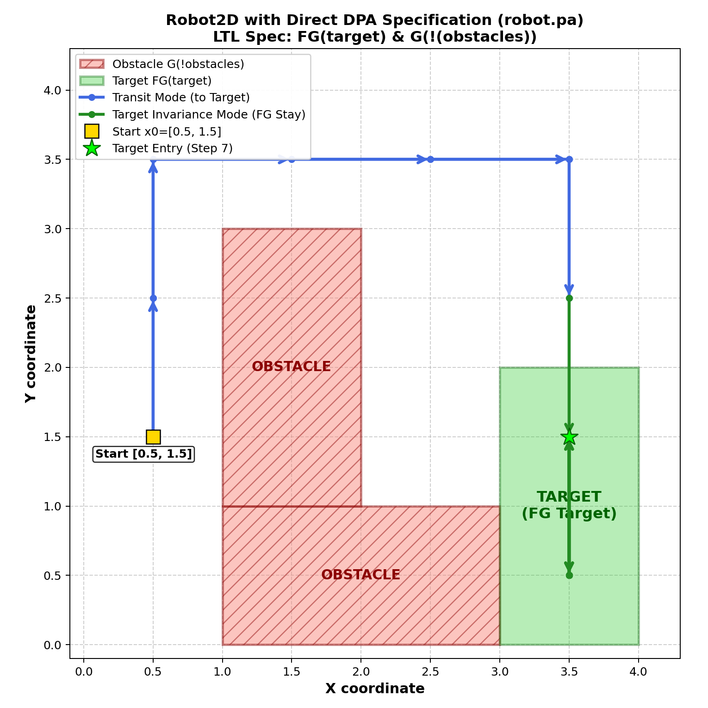
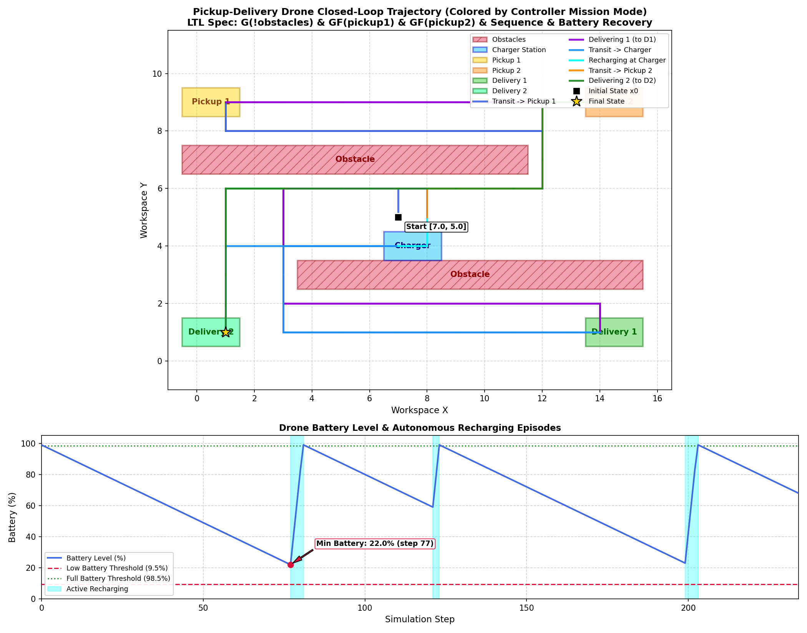
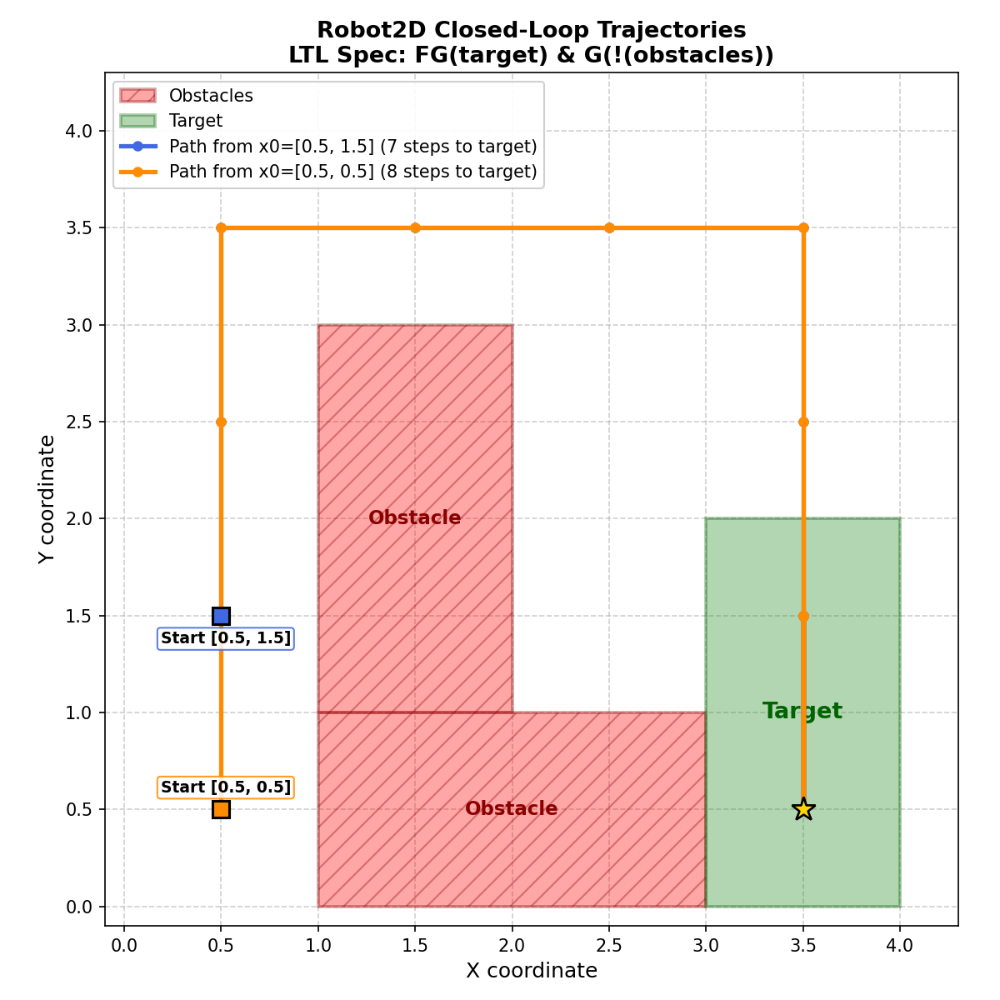

# pFaces-OmegaThreads

[](https://github.com/mkhaled87/pFaces-OmegaThreads/actions/workflows/ci.yml)
[](https://github.com/parallall/pFaces)
[](LICENSE)

> **Note:** This tool works on top of the demo version of pFaces. If you face any LICENSE issues (e.g., expired license), install the latest version of pFaces or use the latest license file from the latest demo version of pFaces. Latest demo version of pFaces can always be found [here](https://github.com/parallall/pFaces/releases).

Automatic design of correct-by-construction software is a becoming a popular approach to design controllers for safety-critical systems.
This eliminates the need for post-testing/post-verification steps.
Design requirements are usually given in a formal language (e.g., [linear temporal logic (LTL)](https://en.wikipedia.org/wiki/Linear_temporal_logic) formulae) and safety-critical systems are described by models such as differential or difference equations. **OmegaThreads** is a tool for parallel automated controller synthesis for dynamical systems to satisfy [ω-regular](https://en.wikipedia.org/wiki/Omega-regular_language) specifications given as LTL formulae.

<p align="center"> 
    
    <br />
    Fig. 1: The Python-Arcade-based 2d-simulator <BR />provided by OmegaThreads.
    This simulation is recorded from the <BR /><a href="/examples/vehicle3d/">Autonomous Vehicle Example</a>.
    The vehicle is supposed to infinitely-often <BR />visit the two targets (target1) and (target2) while not crashing in (avoids). <BR /><BR />
</p>

In a brief, **OmegaThreads** uses [OWL library](https://owl.model.in.tum.de) to construct a deterministic [ω-Automaton](https://en.wikipedia.org/wiki/Ω-automaton) with a parity acceptance condition representing the input LTL specifications.
The given model (e.g., a system of differential equations) of the dynamical system is used to construct a [symbolic model](https://www.hyconsys.com/research.html) that abstracts the model.
**OmegaThreads** then builds a [parity game](https://en.wikipedia.org/wiki/Parity_game) (the model is a player and the controller is a player) using the symbolic model and the specification's Automaton.
Finally, **OmegaThreads** solving the game playing at the controller side using the strategy iteration solver from [Strix](https://strix.model.in.tum.de).
Winning the game results in a closed-loop controller that is guaranteed to enforce the given specification on the dynamical system.
**OmegaThreads** generates the synthesized controller as a [Mealy machine](https://en.wikipedia.org/wiki/Mealy_machine).

In **OmegaThreads**, scalable parallel algorithms are designed to construct symbolic model, construct the parity game and to synthesize the controllers. They are implemented on top of [pFaces](https://github.com/parallall/pFaces) as a kernel that supports parallel execution within CPUs, GPUs and hardware accelerators (HWAs).

More details about theory and techniques behind OmegaThreads can be found in the following tallk:

<p align="center"> 
    <a href="https://www.youtube.com/watch?v=p5e4MFC1ygg">
        
    </a>
</p>

## **Installing and running OmegaThreads using Docker**

Here, we assume you will be using a Linux or MacOS machine. Commands will be slightly different on Windows if you use Windows PowerShell.
We tested OmegaThreads on Docker using Ubuntu Linux 18.04, MacOs 10.15.7 and Windows 10 x46.

First, make sure you have docker installed (see Docker installation guide for: [MacOS](https://docs.docker.com/docker-for-mac/install/), [Ubuntu Linux](https://docs.docker.com/engine/install/ubuntu/) or [Windows](https://docs.docker.com/docker-for-windows/install/)). Also, make sure to [configure Docker to use sufficient resources](https://docs.docker.com/config/containers/resource_constraints/) (e.g., enough CPU cores). Otherwise, OmegaThreads will run slower than expected.

You may work directly with a Docker image we provide or build the Docker image locally.

### **Using OmegaThreads from the pre-built Docker image**

Working with the pre-built version will save you the build time.
It might be however outdated and we always advise that you built an image from the provided Docker file as described in the next section.
The image size is around 1.0 GB and downloading it will take time depending on your internet connection.
First, download the Dockerfile:

``` bash
$ docker pull mkhaled87/omega:latest
```

Once done, run the container and enter the interactive shell:

``` bash
$ docker run -it -v ~/docker_shared:/docker_shared mkhaled87/omega
```

Note that by the previous command, we made a pipe between host and the container (this part: *-v ~/docker_shared:/docker_shared*) which will later allow us to move files (e.g., the synthesized controller) from the container to the host.

Now OmegaThreads is installed and we will test it with a simple example.
In the Docker image, OmegaThreads is located in the director **pFaces-OmegaThreads**.
Navigate to it as follows:

``` bash
/# cd pFaces-OmegaThreads
```

In case you built the Docker image a while ago, there is a chance that we made some updates to **pFaces-OmegaThreads**.
You can get the latest version and build it as follows:

``` bash
/# git pull
/# sh build.sh
```

In the Docker image, we installed Oclgrind to simulate an OpenCL platform/device that utilizes all the CPU cores using threads.
As we use Oclgrind inside Docker, pFaces commands **MUST** be preceded with the command: oclgrind.
For example, to check available devices using Oclgrind and pFaces, run:

``` bash
/# oclgrind pfaces -CG -l
```

Now, run the pickup-delivery drone example and launch it using oclgrind:

``` bash
/# cd examples/pickupdelivery
/# oclgrind pfaces -CG -d 1 -k omega@../../kernel-pack -cfg pickupdelivery.cfg
```

This should take some time (up to 5 minutes), during which pFaces constructs a symbolic model of the system, a parity game and solves it.
Now, move the controller to the host for simulation.
Copy it as follows to the shared folder (we copy some simulation scripts and example-related files as well):

``` bash
/# cp pickupdelivery.cfg /docker_shared/
/# cp pickupdelivery.mdf /docker_shared/
/# cp drone.png /docker_shared/
/# cp simulate.py /docker_shared/
/# cp ../../interface/python/*.py /docker_shared/
/# cp $PFACES_SDK_ROOT/../interface/python/ConfigFileGrammer.pg /docker_shared/
/# cp $PFACES_SDK_ROOT/../interface/python/ConfigReader.py /docker_shared/
```

Now, without closing the running docker container, start a new terminal on the host and simulate the controller (make sure Python 3.6+, Arcade and Parglare are installed before running this command and refer to Python's requirements below for a small installation guide):

``` bash
$ cd ~/docker_shared
$ python3 simulate.py
```

This should start the 2d simulator and simulate the closed loop as follows:

<p align="center"> 
    
    <br />
    Fig. 2: A simulation recorded from the <a href="/examples/pickupdelivery/">Pickup-Delivery Drone</a>.
</p>

The example you just ran corresponds to the problem of controller synthesis for a Pickup-Delivery drone.
The drone in supposed to infinitely-often visit some pickup stations.
Once reaching a pickup station (pickup1 or pickup2), the drone should finish a delivery task by reaching the corresponding delivery station (delivery1 or delivery2).
During the continuos operation, the drone should never hit any of the obstacles.
If the battery of the drone goes into a low-battery state, it should go to the charging station to charge.
In case you like to know more about OmegaThreads, we advise you to start reading the **Getting Started** section below.

### **Building from the provided Dockerfile**

In case you are interessted in building the Docker image locally, you may use the provided [Dockerfile](Dockerfile).
First, download the Dockerfile locally in some directory (we create one here):

``` bash
$ mkdir OmegaThreads
$ cd OmegaThreads
$ curl https://raw.githubusercontent.com/mkhaled87/pFaces-OmegaThreads/master/Dockerfile -o Dockerfile
```

Build the Docker image (don't forget the DOT at the end):

``` bash
$ docker build -t omega:latest .
```

The building process will take proximately 45 minutes.
During the build, you may receive some red-colored messages.
They do not indicate errors, unless you receive an explicit red-colored error message.
Once done, run the container and enter the interactive shell:

``` bash
$ docker run -it -v ~/docker_shared:/docker_shared omega:latest
```

Now, you are inside the container and can use it as described before.

## **Building and running OmegaThreads using Source Code**

### **Prerequisites**

#### pFaces

You first need to have [pFaces](https://github.com/parallall/pFaces) installed and working. Test the installation of pFaces and make sure it recognizes the parallel hardware in your machine by running the following command:

``` bash
$ pfaces -CGH -l
```

where **pfaces** calls pFaces launcher as installed in your machine. This should list all available HW configurations attached to your machine and means you are ready to work with OmegaThreads.


#### Python

If you like to access the generated controller file using Python or simulate the closed-loop behavior using the provided 2d simulator, you need to have Python 3.6+ installed and both Arcade and Parglare packages. To install the required packages, run:

``` bash
$ pip3 install numpy
$ pip3 install arcade
$ pip3 install parglare
```

#### Build Tools Needed before Building pFaces-OmegaThreads

OmegaThreads is given as source code that need to be built before running it. This requires a modern C/C++ compiler such as:

- For windows: Microsoft Visual C++ (OmegaThreads is tested with Visual Studio 2019 community edition) and CMake;
- For Linux/MacOS: GCC/G++.

Make sure you have the following installed:
- Cmake
- wget (not needed for Windows)

For MacOS, we suggest installign Homebrew and using it to install Cmake and WGET.

### **Building OmegaThreads**

The following steps applies to MacOS, Linux and Windows.
For Windows, we suggest using Powershell with access to developer tools of Visual Studio since we will be using CMake.
We assume git is installed.

pFaces uses Boost and you need to nistall boost first. For MacOS, it is advised to use Homebrew ('$ brew install boost'), and for Linus, use 'apt' ('sudo apt install boost'). 
For windows, we advise using VCPkg. Run the following commmand from the VCPkg folder:
``` bash
> .\vcpkg.exe install boost boost:x64-windows
```

Now we install pFaces-OmegaThreads. Clone this repo:
``` bash
$ git clone --depth=1 https://github.com/mkhaled87/pFaces-OmegaThreads
```
Then, navigate to the created repo folder:
``` bash
$ cd pFaces-OmegaThreads
```

Now, we build the OWL library. It is used to construct a parity Automaton from the input LTL specifications. If you are using Linux or MacOs, we automated the installation of OWL using the a script. On MacOS/Linux, run the following command to install OWL and its requirements (mainly GraalVM 20.1):
``` bash
$ cd ./kernel-driver/lib/ltl2dpa/
$ sh install-owl.sh
$ cd ../../../
```
On Windows, this should be changed to run the BAT file instead:
``` bash
$ cd .\kernel-driver\lib\ltl2dpa
$ .\install-owl.bat
$ cd ..\..\..
```

If you are using Windows, you will have to manually install OWL. Please refer to the installation [guide of OWL](https://gitlab.lrz.de/i7/owl/blob/master/README.md) for help. Once built and generated a static library (a .lib a), use it in the link settings in Visual Studio. You will also need to point to the include directories of OWL in the include settings of Visual Studio. Once we test **OmegaThreads** on Windows, we will update this section with details on the installation of OWL or we will create an installation BATCH for it.


Finally, build OmegaThreads by running the build script ('build.sh' for MacOS/Linux, or 'build.bat' for Windows).


### **Running an example**

Navigate to any of the examples in the directory [/examples](/examples). Within each example, one or more .cfg files are provided. Config files tells OmegaThreads about the system under consideration and the requirements it should consider when designing a controller for the system.

Say you navigated to the example in [/examples/pickupdelivery](/examples/pickupdelivery) and you want to launch OmegaThreads with the config file [pickupdelivery.cfg](/examples/pickupdelivery/pickupdelivery.cfg), then run the following command from any terminal located in the example folder:

``` bash
$ pfaces -CGH -d 1 -k omega@../../kernel-pack -cfg pickupdelivery.cfg -p
```

where **pfaces** calls pFaces launcher, "-CGH -d 1" asks pFaces to run OmegaThreads in the first device of all available devices, "-k omega@../../kernel-pack" tells pFaces about OmegaThreads and where it is located, "-cfg pickupdelivery.cfg" asks pFaces to hand the configuration file to OmegaThreads, and "-p" asks pFaces to collect profiling information. Make sure to replace each / with \ in case you are using Windows command line.

For this example, you may also directly use the script **solve.sh** instead of writing the complete pFaces command:

``` bash
$ sh solve.sh
```

Once the controller is synthesized, it is saved to an (.mdf) file. You can now use the provided Python interface and 2d simulator to simulate the closed loop:

``` bash
$ python3 simulate.py
```

This should start the 2d simulator and simulate the closed loop as depicted in Fig. 2.

## **Getting started with OmegaThreads**

In the previous sections, you installed OmegaThreads and ran it with a small example.
We now tell you more about it.

### **File structure of OmegaThreads**

- [examples](/examples): the folder contains pre-designed examples.
- [interface](/interface): the folder contains the Python interface to access the files generated by OmegaThreads.
- [kernel-driver](/kernel-driver): the folder contains C++ source codes of OmegaThreads pFaces kernel driver.
- [kernel-pack](/kernel-pack): the folder contains the OpenCL codes of the OmegaThreads and will finally hold the binaries of the loadable kernel of OmegaThreads.

### **The configuration files**

Each configuration file corresponds to a case describing a system and the requirements to be used to synthesize a controller for it. Config files are plain-text files with scopes and contents (e.g., "scope_name { contents }"), where the contents is a list of ;-separated key="value" pairs. Note that values need to be enclosed with double quotes. For a better understanding of such syntax, take a quick look to this [example config file](/examples/robot2d/robot.cfg).

The following are all the keys that can be used in OmegaThreads config files:

- **project_name**: a to describe the name of the project (the case) and will be used as name for output files. If not provided, this key will be set to *"empty_project"*.

- **system.states.dimension**: declares the dimension (N) of the dynamical system.

- **system.states.first_symbol**: declares a vector of size N describing the fist symbol in the states set of the symbolic model.

- **system.states.last_symbol**: declares a vector of size N describing the last symbol in the states set of symbolic model.

- **system.states.quantizers**: declares a vector of size N describing the space between each two symbols in the state set of the symbolic model.

- **system.states.initial_set**: declares a the initial set of the system.

- **system.states.subsets.names**: declares a comma separated list of names for atomic propositions on the states set. A set with name (**ABC**) should be followed with a mapping declaration in **system.states.subsets.mapping_ABC** describing which state sets map to the atomic proposition **ABC**.

- **system.controls.dimension**: declares the dimension (P) of the controls of the dynamical system.

- **system.controls.first_symbol**: declares a vector of size P describing the fist symbol in the controls set of the symbolic model.

- **system.controls.last_symbol**: declares a vector of size P describing the last symbol in the controls set of symbolic model.

- **system.controls.quantizers**: declares a vector of size P describing the space between each two symbols in the controls set of the symbolic model.

- **system.controls.subsets.names**: declares a comma separated list of names for atomic propositions on the controls set. A set with name (**ABC**) should be followed with a mapping declaration in **system.controls.subsets.mapping_ABC** describing which control sets map to the atomic proposition **ABC**.

- **system.dynamics.code_file**: the relative-path/name of OpenCL file describing the dynamics of the system. The path should be relative to the config file. The OpenCL file should declare at least a function with the signature:

``` C
void model_post(concrete_t* post_x_lb, concrete_t* post_x_ub,  const concrete_t* x, const concrete_t* u);
```

- **system.dynamics.code_defines**: semicolon(;)-separated list of Key=Value items. The keys are used as defines to be passed to the code file. Simply, the OpenCl compliler is called with the option -DKey=Value, for each item in the list.

- **system.write_symmodel**: a "true" or "false" value that instructs OmegaThreads to write/not-write the constructed symbolic model.

- **specifications.ltl_formula**: the LTL formula describing the specifications to be enforced on the system. Only the atomic propositions declared in **system.states.subsets.names** and **system.controls.subsets.names** can be used.

- **specifications.dpa_file**: point to file describing the a DPA for the specification. You cant use this option if you already specified the specifications as LTL. See the [robot_dpa](/examples/robot2d_dpa) for hints about the DPA file. We will soon be publishing more information about it.

- **specifications.write_dpa**: a "true" or "false" value that instructs OmegaThreads to write/not-write the constructed parity automaton.

- **implementation.implementation**: the type of controller implementation. This can currently only be "mealy_machine".

- **implementation.generate_controller**: a "true" or "false" value that instructs OmegaThreads to save the raw controller or not.

- **implementation.generate_code**: a "true" or "false" value that instructs OmegaThreads to generate code from the controller or not.

- **implementation.code_type**: currently should only be set to "ros-python".

- **implementation.module_name**: declares the name of the generated code module.

- **simulation.window_width**: a number that specifies the width of the simulation window in pixels.

- **simulation.window_height**: a number that specifies the height of the simulation window in pixels.

- **simulation.widow_title**: a text that specifies the title of the simulation window.

- **simulation.initial_state**: should be either **center**, **random** or a vector of size n. **center** asks the simulator to start the system at the center of the initial set. **random** asks the simulator to start the simulation in a random point in the initial set. Otherwise, the specified vector is used as initial state for the system.

- **simulation.controller_file**: a path to the controller file synthesized by OmegaThreads to be used by the simulator.

- **simulation.system_image**: an image to be used by the simulator to visualize the system.

- **simulation.system_image_scale**: a multiplier for the system's image.

- **simulation.step_time**: the simulation step time.

- **simulation.use_ode**: a "true" or "false" value that instructs the simulator to use/not-use an ODE solver.

- **simulation.visualize_3rdDim**: a "true" or "false" value that instructs the simulator to visualize 3-dimensional systems. The third dimension is visualized as the angle of the system's image.

- **simulation.skip_APs**: a list of atomic proposition to be excluded from the visualization.

- **simulation.model_dump_file**: a dump file of the symbolic model to be checked against the dynamics.


## **Verified Reactive LTL Synthesis Benchmarks**

OmegaThreads includes a comprehensive suite of verified reactive synthesis benchmarks demonstrating continuous dynamics abstraction, LTL-to-DPA compilation via Owl, parity game arena construction, winning strategy synthesis via McNaughton/Zielonka algorithms, and closed-loop verification of the resulting Mealy machine controllers.

All benchmarks feature standalone, headless closed-loop verification scripts (`verify_closedloop.py`) that simulate the continuous/discrete system, assert formal LTL properties (safety, liveness, recurrence, invariance, and periodic lasso detection), and render publication-quality visual plots.

---

### **1. `vehicle3d`: 3D Kinematic Vehicle Patrol with Growth Bound ODE Abstraction**

* **Directory**: [`examples/vehicle3d`](examples/vehicle3d)
* **Continuous Dynamics**: 3D non-linear vehicle kinematics ODE (sampling period $\Delta t = 0.3\,\text{s}$):
  $$\dot{x} = v \frac{\cos\left(\arctan\left(\frac{1}{2}\tan\delta\right) + \theta\right)}{\cos\left(\arctan\left(\frac{1}{2}\tan\delta\right)\right)}, \quad \dot{y} = v \frac{\sin\left(\arctan\left(\frac{1}{2}\tan\delta\right) + \theta\right)}{\cos\left(\arctan\left(\frac{1}{2}\tan\delta\right)\right)}, \quad \dot{\theta} = v \tan\delta$$
  State space $(x, y, \theta) \in [0, 5] \times [0, 5] \times [-1.6, 1.6]$, control space $(v, \delta) \in [-2.0, 2.0] \times [-0.8, 0.8]$. Over-approximated reach sets are computed via 4th-order Runge-Kutta (RK4) with growth-bound radius dynamics.
* **LTL Specification**:
  $$\mathbf{GF}(\text{target1}) \land \mathbf{GF}(\text{target2}) \land \mathbf{G}(\neg \text{obstacles}) \land \mathbf{G}(\text{lowspeed})$$
  - $\text{target1} = [3.7, 5.2] \times [-0.2, 1.3] \times [-3.65, 3.65]$
  - $\text{target2} = [3.7, 5.2] \times [3.7, 5.2] \times [-3.65, 3.65]$
  - $\text{obstacles} = [1.5, 5.5] \times [1.3, 3.7] \times [-3.65, 3.65]$
  - $\text{lowspeed} = [-1.7, 1.7] \times [-0.9, 0.9]$
* **Synthesis & Verification Details**:
  - Owl translates the specification into a 3-state DPA.
  - Constructs a parity game arena with **1,132,057 model nodes** and **7,824,529 model edges**.
  - Synthesizes a Mealy controller (`vehicle.mdf`) with internal automaton modes in ~65 seconds.
  - Automated closed-loop simulation verifies infinite recurrence between Target 1 and Target 2, complete obstacle avoidance, and strict compliance with low-speed control bounds.
* **Run Commands**:
  ```bash
  cd examples/vehicle3d
  pfaces -CG -d 1 -k omega@../../kernel-pack -cfg vehicle.cfg
  python3 verify_closedloop.py
  ```
* **Closed-Loop Verification Plot**:

  <p align="center">
    
  </p>

---

### **2. `deepracer`: Amazon DeepRacer 4D Bicycle Model (9-Step Periodic Lasso Attractor)**

* **Directory**: [`examples/deepracer`](examples/deepracer)
* **Continuous Dynamics**: 4D non-linear bicycle ODE for Amazon DeepRacer with $\Delta t = 0.5\,\text{s}$:
  $$\dot{x} = v \cos\theta, \quad \dot{y} = v \sin\theta, \quad \dot{\theta} = \frac{v}{L} \tan\delta, \quad \dot{v} = a v + b u_{\text{speed}}$$
  where $L = 0.165\,\text{m}$, steering angle $\delta = -0.1167 u_0^3 + 0.01949 u_0^2 + 0.3828 u_0 - 0.0293$, and $(a, b)$ are empirical motor acceleration parameters. State space $(x, y, \theta, v) \in [-1.0, 1.0] \times [-1.0, 1.0] \times [-3.2, 3.2] \times [-1.5, 1.5]$.
* **LTL Specification**:
  $$\mathbf{GF}(\text{target1}) \land \mathbf{GF}(\text{target2}) \land \mathbf{G}(\neg \text{obstacles})$$
  - $\text{target1} = [0.6, 1.0] \times [0.6, 1.0] \times [-3.2, 3.2] \times [-1.8, 1.8]$
  - $\text{target2} = [-1.0, -0.6] \times [-1.0, -0.6] \times [-3.2, 3.2] \times [-1.8, 1.8]$
  - $\text{obstacles} = [-0.3, 0.3] \times [-0.3, 0.3] \times [-3.2, 3.2] \times [-1.8, 1.8]$
* **Synthesis & Verification Details**:
  - Parity game arena with **2,209,726 model nodes** and **2,209,734 model edges** solved in **11.5 seconds**.
  - Closed-loop execution establishes a deterministic **9-step periodic limit cycle (lasso recurrence)** between Target 1 and Target 2 while dodging the central obstacle.
* **Run Commands**:
  ```bash
  cd examples/deepracer
  pfaces -CG -d 1 -k omega@../../kernel-pack -cfg deepracer_xsmall.cfg
  python3 verify_closedloop.py
  ```
* **Closed-Loop Verification Plot**:

  <p align="center">
    
  </p>

---

### **3. `robot2d_dpa`: Direct DPA Specification Input Pipeline**

* **Directory**: [`examples/robot2d_dpa`](examples/robot2d_dpa)
* **Discrete Dynamics**: 2D discrete grid robot moving in 4 cardinal directions ($4 \times 4$ quantized grid, $x_0 = [0.5, 1.5]$):
  $$x_{k+1} = x_k + \Delta(u_k), \quad u_k \in \{0: \text{left}, 1: \text{up}, 2: \text{right}, 3: \text{down}\}$$
* **Specification**: Direct input of a Deterministic Parity Automaton file (`robot.pa`), bypassing runtime Owl compilation:
  $$\mathbf{FG}(\text{target}) \land \mathbf{G}(\neg \text{obstacles})$$
  - $\text{target} = [3.0, 4.0] \times [0.0, 2.0]$
  - $\text{obstacles} = [1.0, 3.0] \times [0.0, 1.0] \cup [1.0, 2.0] \times [1.0, 3.0]$
* **Synthesis & Verification Details**:
  - Exercises OmegaThreads' native DPA file loader and parity arena constructor in **0.07 seconds**.
  - Verifies that the robot navigates safely around the L-shaped obstacle, reaches the target region, and remains invariant within the target region permanently (verified for 10 consecutive steps).
* **Run Commands**:
  ```bash
  cd examples/robot2d_dpa
  pfaces -CG -d 1 -k omega@../../kernel-pack -cfg robot.cfg
  python3 verify_closedloop.py
  ```
* **Closed-Loop Verification Plot**:

  <p align="center">
    
  </p>

---

### **4. `pickupdelivery`: Multi-Mission Drone with Battery Recharging (122-Step Periodic Lasso)**

* **Directory**: [`examples/pickupdelivery`](examples/pickupdelivery)
* **Hybrid/Discrete Dynamics**: 3D state space $(x, y, \text{battery})$ on a $16 \times 11 \times 100$ grid. Motion drains 1% battery per step; visiting the charging station $[6.5, 8.5] \times [3.5, 4.5]$ restores 20% battery per step up to 99%.
* **LTL Specification**:
  $$\mathbf{G}(\neg \text{obstacles}) \land \mathbf{GF}(\text{pickup1}) \land \mathbf{GF}(\text{pickup2}) \land \mathbf{G}(\text{pickup1} \to ((\neg \text{charger} \land \neg \text{pickup2} \land \neg \text{delivery2}) \mathbin{\mathbf{U}} \text{delivery1})) \land \mathbf{G}(\text{pickup2} \to ((\neg \text{charger} \land \neg \text{pickup1} \land \neg \text{delivery1}) \mathbin{\mathbf{U}} \text{delivery2})) \land \mathbf{G}(\text{lowbattery} \to (\text{charger} \mathbin{\mathbf{U}} \text{fullbattery}))$$
* **Synthesis & Verification Details**:
  - Owl compiles the complex multi-goal sequential specification into a 10-state DPA.
  - Parity game with 252,316 nodes solved in 2.5 seconds.
  - Closed-loop verification verifies full multi-mission patrol cycles (Mission 1: Pickup 1 $\to$ Delivery 1; Mission 2: Pickup 2 $\to$ Delivery 2), autonomous recharging without battery depletion, and converges into a **122-step periodic limit cycle**.
* **Run Commands**:
  ```bash
  cd examples/pickupdelivery
  pfaces -CG -d 1 -k omega@../../kernel-pack -cfg pickupdelivery.cfg
  python3 verify_closedloop.py
  ```
* **Closed-Loop Verification Plot**:

  <p align="center">
    
  </p>

---

### **5. `robot2d`: 2D Grid Robot with LTL Targets and Obstacles**

* **Directory**: [`examples/robot2d`](examples/robot2d)
* **Discrete Dynamics**: 2D discrete grid navigation matching `robot.cl`.
* **LTL Specification**:
  $$\mathbf{FG}(\text{target}) \land \mathbf{G}(\neg \text{obstacles})$$
  - $\text{target} = [3.0, 4.0] \times [0.0, 2.0]$
  - $\text{obstacles} = [1.0, 3.0] \times [0.0, 1.0] \cup [1.0, 2.0] \times [1.0, 3.0]$
* **Synthesis & Verification Details**:
  - Owl compiles formula to 2-state DPA; solves 53-node parity game in <0.5s.
  - Synthesizes Mealy machine (`robot.mdf`) and symbolic model dump (`robot.symmodel`).
  - Closed-loop verification confirms target reachability, obstacle avoidance, and target invariance.
* **Run Commands**:
  ```bash
  cd examples/robot2d
  pfaces -CG -d 1 -k omega@../../kernel-pack -cfg robot.cfg
  python3 verify_closedloop.py
  ```
* **Closed-Loop Verification Plot**:

  <p align="center">
    
  </p>

---

## Future Features
- [x] CMake version of the build.
- [x] A parallel version of the game solver (CPU-only)
- [x] Code-generation: ROS nodes in Python representing the controllers.
- [ ] Code-generation: C/C++ and VHDL/Verilog code generators for the Mealy machines.
- [ ] Activate and test the support for LTL-f.
- [ ] An OpenCL-based version of the parity game constructor.
- [ ] Re-Parallelize the game solver in OpenCL.
- [x] More examples: DeepRacer.
- [x] A guide for the Docker image in the README.
- [ ] Documentation.
